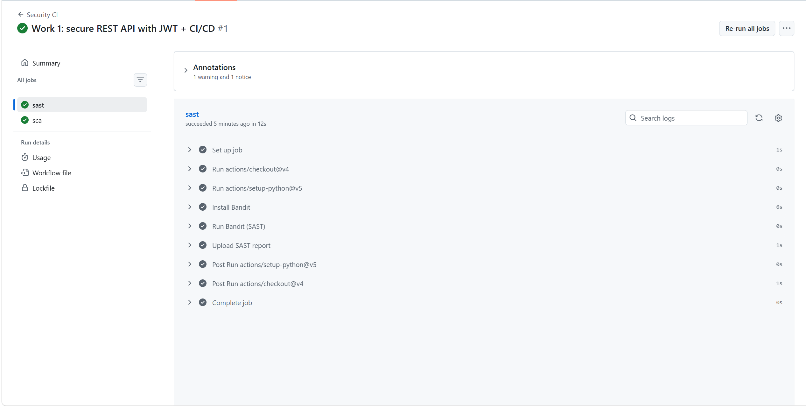
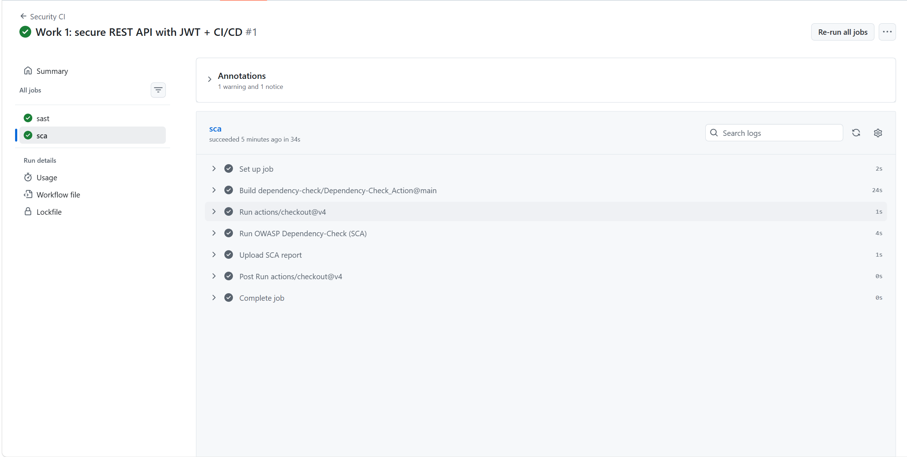

# Secure REST API — Work 1

HDU Information Security Laboratory Work 1: **Secure REST API Development with
CI/CD and Real CVE Vulnerability Analysis**.

This repository contains a small Flask + SQLite API that demonstrates the full
security lifecycle described in the lab manual:

1. A functional API protected against the OWASP Top 10 (SQLi, XSS, broken auth).
2. A GitHub Actions CI/CD pipeline that runs SAST (Bandit) and SCA
   (OWASP Dependency-Check) on every push.
3. Reproduction, root-cause analysis, and remediation of a real CVE
   (`CVE-2018-1000656`) in a controlled Docker/Vulhub environment.

---

## 1. Project & API description

| Method | Endpoint           | Auth        | Description                                  |
|--------|--------------------|-------------|----------------------------------------------|
| POST   | `/auth/register`   | none        | Create a new account (password hashed)       |
| POST   | `/auth/login`      | none        | Authenticate and return a JWT                |
| GET    | `/api/data`        | **JWT required** | Return the list of posts (user data escaped) |

### How to run

```bash
python -m venv venv
venv\Scripts\activate          # Windows  (or: source venv/bin/activate)
pip install -r requirements.txt
python db.py                   # create SQLite schema + seed data
python app.py                  # start the server on http://localhost:5000
```

### How to call

```bash
# 1. Register a user
curl -X POST http://localhost:5000/auth/register \
  -H "Content-Type: application/json" \
  -d '{"username":"alice","password":"S3cure!Pass"}' 

# 2. Login -> get a JWT
curl -X POST http://localhost:5000/auth/login \
  -H "Content-Type: application/json" \
  -d '{"login":"admin","password":"admin123"}'
# -> {"token":"eyJhbGciOiJIUzI1NiIs..."}

# 3. Access protected data WITH the token
curl http://localhost:5000/api/data \
  -H "Authorization: Bearer <TOKEN>"

# 4. Access protected data WITHOUT the token -> 401
curl http://localhost:5000/api/data
# -> {"error":"missing token"}
```

---

## 2. Implemented security measures

### 2.1 SQL injection (SQLi) — parameterized queries

Every SQL statement uses **parameterized queries** (the `?` placeholder) so user
input is never concatenated into the SQL string.

```python
user = db.execute(
    "SELECT * FROM users WHERE username = ?", (username,)
).fetchone()
```

Because the value is bound as a parameter, an input such as
`admin" OR 1=1 --` is treated as a literal string, not as SQL.

### 2.2 Cross-site scripting (XSS) — output escaping

All user-supplied values returned to the client are passed through
`escape()` before being serialised into the JSON response.

```python
result = [{"title": escape(p["title"]),
           "content": escape(p["content"]),
           "author": escape(p["author"])} for p in posts]
```

This neutralises HTML/JavaScript (e.g. `<script>alert(1)</script>`) embedded in
stored data.

### 2.3 Broken authentication — JWT + password hashing

- **JWT**: on successful login the server issues a signed JWT; a `require_auth`
  decorator verifies the token on every protected endpoint.
- **Password hashing**: passwords are stored using **scrypt** (one of the
  algorithms required by the lab manual — bcrypt/scrypt/Argon2), via
  `generate_password_hash` / `check_password_hash` — never in plaintext.

```python
password_hash = generate_password_hash(password, method="scrypt")
```

---

## 3. CI/CD pipeline (SAST + SCA)

Defined in [`.github/workflows/ci.yml`](.github/workflows/ci.yml). On every
push / pull request to `main`:

- **SAST** — [Bandit](https://bandit.readthedocs.io/) scans the Python source
  for common security issues and uploads a JSON report.
- **SCA** — [OWASP Dependency-Check](https://owasp.org/www-project-dependency-check/)
  scans the third-party dependencies for known CVEs and uploads an HTML report.

### Reports

> _Screenshot placeholders — replace with screenshots from the `Actions` tab of
> your repository showing a successful run._





A link to the last successful pipeline run:

> _Paste the `https://github.com/<you>/secure-api-lab/actions/runs/<id>` URL here._

---

## 4. CVE reproduction & remediation

Selected vulnerability: **CVE-2018-1000656**.

### 4.1 Summary

A denial-of-service / information-leak issue in Flask (through its bundled
Werkzeug debugger) when the application is run with the debugger enabled and a
predictable/weak PIN. An attacker who can obtain the debugger PIN can execute
arbitrary code, and certain inputs can crash the process or leak internal state.

### 4.2 Reproduction steps

```bash
git clone https://github.com/vulhub/vulhub.git
cd vulhub/flask/CVE-2018-1000656
cat README.md               # read the vulnerability description + payloads
docker-compose up -d        # start the vulnerable environment
# ... follow README.md to trigger the bug (record every command + screenshot) ...
```

> _Paste your reproduction commands and screenshots here._

### 4.3 Root cause analysis

> _Write the root cause in your own words: e.g. the vulnerability is a
> configuration/debugging issue — running Flask with the debugger enabled and a
> weak secret/PIN in production exposes the Werkzeug debugger, which allows
> arbitrary code execution / information disclosure. Explain the difference
> between a logic error, improper input handling, and a configuration problem,
> and why this one is primarily a configuration problem._

### 4.4 Applied fix

```bash
docker-compose down         # stop the vulnerable environment
# edit docker-compose.yml / Dockerfile (upgrade Flask, disable debug)
docker-compose up --build -d  # rebuild and start the fixed environment
```

The fix (see [`cve/docker-compose.yml`](cve/docker-compose.yml)) upgrades Flask
to a patched version and disables the debug mode so the vulnerable debugger is
no longer exposed.

### 4.5 Verification

Repeat the exact same exploitation steps from 4.2 — the attack no longer
succeeds, and the normal application functionality still works (regression
test).

> _Paste screenshots proving the attack fails on the fixed version here._

---

## 5. Repository structure

```
.
├── app.py                      # Flask application (3 endpoints)
├── db.py                       # SQLite schema + seed data
├── requirements.txt            # Python dependencies
├── .github/workflows/ci.yml    # CI/CD (SAST + SCA)
├── cve/
│   ├── docker-compose.yml      # fixed version for CVE-2018-1000656
│   └── CVE-2018-1000656.md     # CVE analysis report
└── README.md
```

## 6. Control questions (brief answers)

1. **bcrypt/scrypt vs SHA-256** — bcrypt/scrypt are slow, salted key-derivation
   functions with an adjustable cost factor, designed for password hashing;
   SHA-256 is fast, unsalted by itself, and vulnerable to brute-force and
   rainbow-table attacks.
2. **SAST vs DAST** — SAST analyses source code without running it; DAST tests a
   running application from the outside.
3. **JWT mechanism** — header.payload.signature; the server verifies the
   signature with its secret key, and checks `exp`/claims.
4. **Dependency risks** — unpatched third-party libraries can introduce known
   CVEs (supply-chain / SCA issues).
5. **Docker + Vulhub advantages** — reproducible, isolated, disposable
   environments; no risk to the host.
6. **Vulnerability vs exploit** — a vulnerability is a weakness; an exploit is
   code that takes advantage of it. We reproduced an exploit against a known
   CVE.
7. **Regression testing** — a patch must not break legitimate functionality.
8. **Why CVEs matter to a security specialist** — they map known weaknesses to
   real attacker techniques (see MITRE ATT&CK / NVD).
